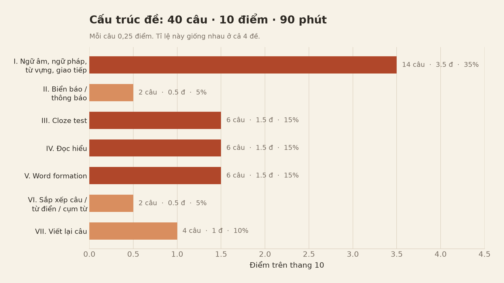
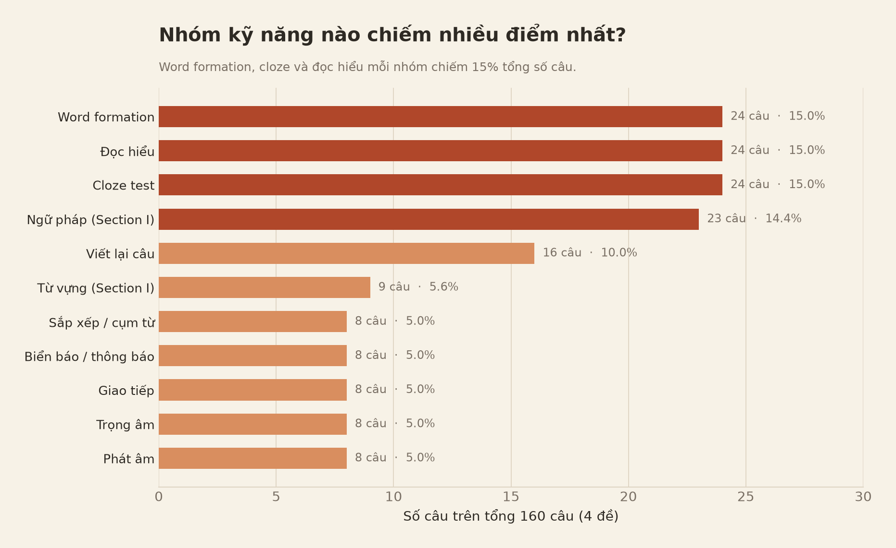
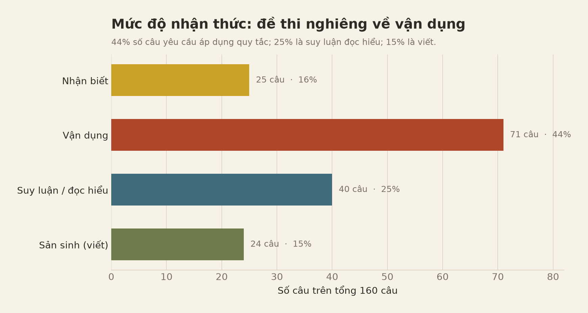
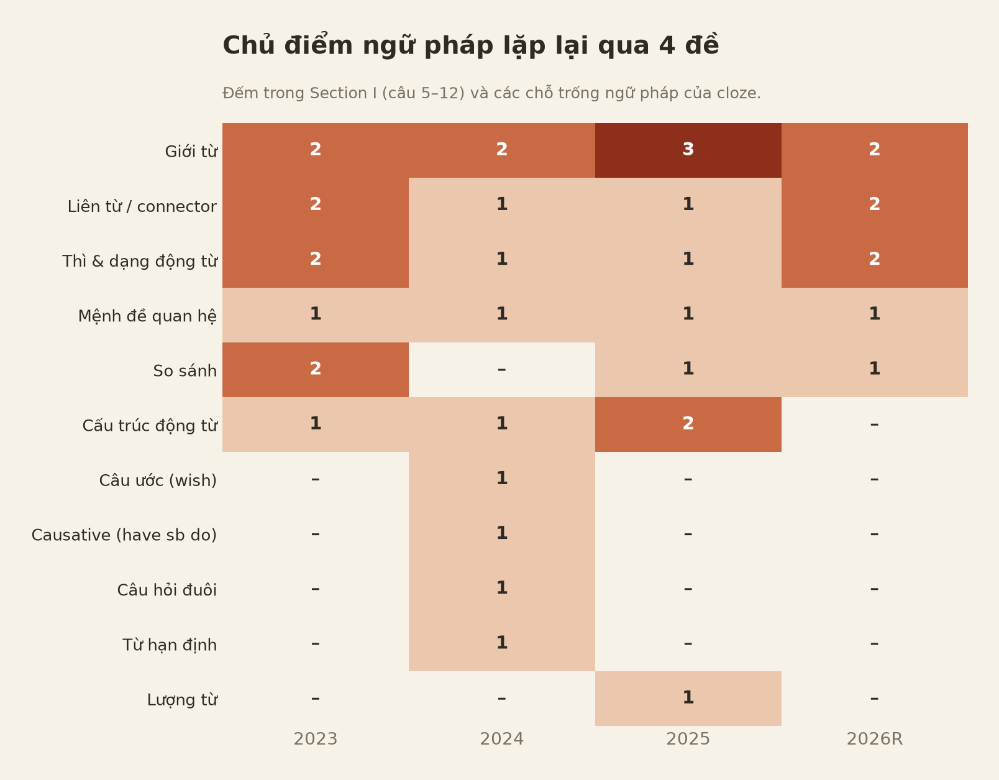
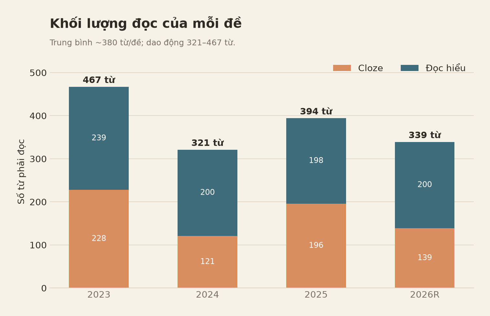
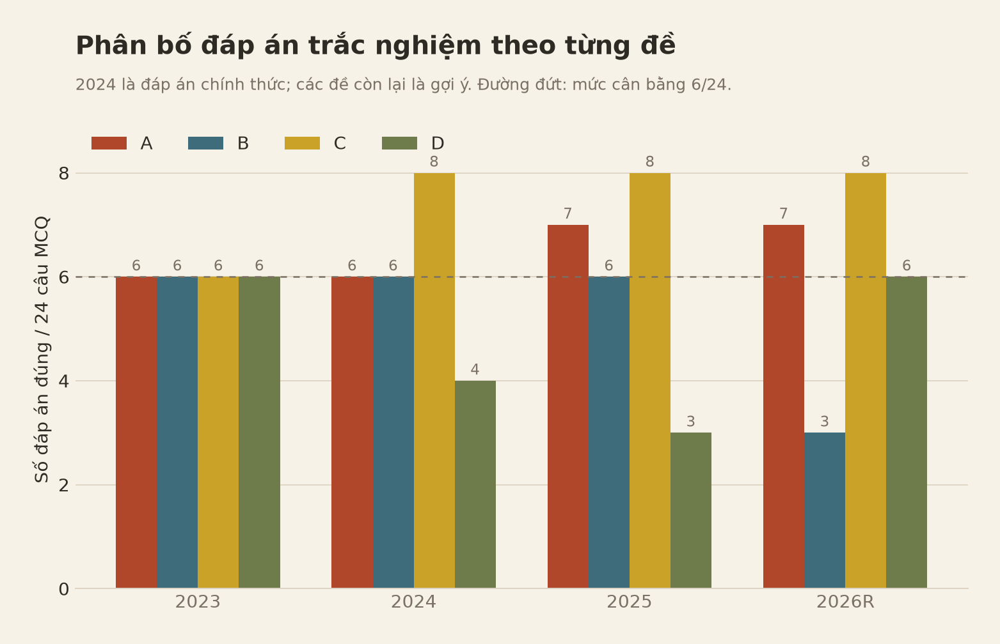

# Đề thi tuyển sinh lớp 10 môn Tiếng Anh TP.HCM
## Phân tích dữ liệu 4 đề: 2023 – 2026

**Phạm vi:** 3 đề chính thức (2023–2024, 2024–2025, 2025–2026) và 1 đề tham khảo 2026.
**Dữ liệu:** 160 câu hỏi, 40 câu/đề, 10 điểm/đề, thời gian 90 phút.
**Đơn vị phân tích:** từng câu (item-level), không chỉ thống kê theo phần.

> **Lưu ý về đáp án:** PDF đề 2024–2025 có đáp án chính thức ở cuối. Các đề 2023–2024, 2025–2026 và đề tham khảo 2026 không kèm đáp án; các đáp án trong báo cáo này do người phân tích tự giải và được ghi rõ là **gợi ý**. Khi dùng để dạy hoặc ôn tập, nên đối chiếu lại với đáp án của Sở nếu có.

---

## 1. Kết luận nhanh

1. **Cấu trúc đề gần như bất biến:** 40 câu, 10 điểm, 90 phút, mỗi câu 0,25 điểm. Bảy phần có tỉ lệ điểm cố định **35% – 5% – 15% – 15% – 15% – 5% – 10%**.
2. **“Bản đồ câu hỏi” giống nhau ở cả 4 đề:** câu 1–4 phát âm/trọng âm, câu 5–12 ngữ pháp–từ vựng, câu 13–14 giao tiếp, câu 15–16 biển báo, câu 17–22 cloze, câu 23–26 True/False, câu 27–28 đọc hiểu, câu 29–34 word formation, câu 35–36 Section VI, câu 37–40 viết lại câu.
3. **Ba nhóm kỹ năng nặng nhất, mỗi nhóm 15% số câu:** word formation, cloze và đọc hiểu. Cộng thêm ngữ pháp Section I (14,4%), bốn nhóm này chiếm **59,4%** tổng số câu.
4. **Đề nghiêng về vận dụng, không đánh đố:** 44% câu yêu cầu áp dụng quy tắc, 25% suy luận/đọc hiểu, 16% nhận biết, 15% sản sinh (viết).
5. **Sáu chủ điểm ngữ pháp lõi chiếm 87% item ngữ pháp:** giới từ (9 item), liên từ (6), thì/dạng động từ (6), mệnh đề quan hệ (4), so sánh (4), cấu trúc động từ (4).
6. **Word formation có công thức rõ ràng:** mỗi đề 6 câu, luôn là **2 danh từ + 2 tính từ + 1 trạng từ + 1 động từ**. Đây là phần dễ luyện nhất để lấy 1,5 điểm.
7. **Đọc hiểu có cấu trúc cố định:** 4 câu True/False + 1 câu ý chính/tiêu đề + 1 câu chi tiết/Tham chiếu/NOT mentioned/cảm xúc. Ba đề chính thức (theo đáp án hiện có) đều có đúng **2 True + 2 False**.
8. **Section VI là phần duy nhất thay đổi format:** đề 2023 và 2024 sắp xếp câu → đề 2025 điền từ theo mục từ điển → đề tham khảo 2026 điền cụm từ cho sẵn. Cả hai dạng mới đều kiểm tra **cụm từ cố định (lexical chunks)**, không phải sắp xếp câu.
9. **Đề tham khảo 2026 có hai tín hiệu đáng chú ý:** Section I tăng từ vựng lên 4 câu (giảm ngữ pháp còn 4 câu) và chủ đề cloze là **deepfake/AI**.
10. **Nhóm “điểm nhanh” chiếm 3,5 điểm:** phát âm + trọng âm (1,0 điểm), biển báo (0,5), giao tiếp (0,5), word formation (1,5). Đây là vùng nên cày trước.

---

## 2. Nguồn dữ liệu và cách mã hoá

| Đề | Năm học | Loại | Số trang | Đáp án |
|---|---|---|---|---|
| `TS-10-TA-TPHCM-2023-2024-1.pdf` | 2023–2024 | Chính thức | 4 | Tự giải – gợi ý |
| `de-tieng-anh-2776.pdf` | 2024–2025 | Chính thức | 4 | **Chính thức** (cuối PDF) |
| `de-thi-ts10-nam-hoc-2025-2026-mon-tieng-anh-72283.pdf` | 2025–2026 | Chính thức | 4 | Tự giải – gợi ý |
| `english-thanh-nien-3232.pdf` | 2026 | Đề tham khảo | 3 | Tự giải – gợi ý |

**Cách làm:**

- Trích văn bản bằng `pdftotext -layout`, sau đó render trang PDF thành ảnh để kiểm tra các biển báo, thông báo và phần bị lỗi font.
- Mã hoá 160 câu theo 12 trường: đề, số câu, phần, format, nhóm kỹ năng, tiểu kỹ năng, chủ điểm ngữ pháp, mức nhận thức, đáp án, nguồn đáp án, độ tin cậy, ghi chú.
- Phân mức nhận thức theo 4 bậc: **Nhận biết** (phát âm, trọng âm, nghĩa từ), **Vận dụng** (áp dụng quy tắc ngữ pháp, word form, cloze), **Suy luận** (đọc hiểu, biển báo, giao tiếp), **Sản sinh** (viết lại câu, sắp xếp/điền cụm từ).
- Dữ liệu chi tiết nằm trong `analysis/exam_items.csv` và `analysis/passages.csv`.

> Việc gán nhóm kỹ năng là một cách mã hoá có chủ đích: một câu có thể chạm nhiều kỹ năng cùng lúc. Các con số dưới đây dùng để so sánh tương đối và phát hiện quy luật, không phải một “công thức chấm điểm” tuyệt đối.

---

## 3. Bản đồ đề thi: 40 câu được sắp xếp như thế nào?

### 3.1. Bảy phần và trọng số điểm

| Phần | Nội dung | Số câu | Điểm | Tỉ lệ |
|---|---|---:|---:|---:|
| I | Ngữ âm, ngữ pháp, từ vựng, giao tiếp | 14 | 3,5 | 35% |
| II | Biển báo / thông báo | 2 | 0,5 | 5% |
| III | Cloze test | 6 | 1,5 | 15% |
| IV | Đọc hiểu (4 True/False + 2 MCQ) | 6 | 1,5 | 15% |
| V | Word formation | 6 | 1,5 | 15% |
| VI | Sắp xếp câu / từ điển / cụm từ | 2 | 0,5 | 5% |
| VII | Viết lại câu | 4 | 1,0 | 10% |
| **Tổng** |  | **40** | **10** | **100%** |

Tỉ lệ này **giống hệt nhau ở cả 4 đề**, kể cả đề tham khảo 2026. Nói cách khác, học sinh có thể biết trước “điểm rơi” của từng phần.

### 3.2. Bản đồ câu hỏi chi tiết (ổn định 4/4 đề)

| Câu | Nội dung | Điểm |
|---|---|---:|
| 1–2 | Phát âm (2 câu) | 0,5 |
| 3–4 | Trọng âm (2 câu) | 0,5 |
| 5–12 | Ngữ pháp + từ vựng (8 câu) | 2,0 |
| 13–14 | Giao tiếp (2 câu) | 0,5 |
| 15–16 | Biển báo / thông báo (2 câu) | 0,5 |
| 17–22 | Cloze (6 câu) | 1,5 |
| 23–26 | True/False (4 câu) | 1,0 |
| 27–28 | Đọc hiểu MCQ (2 câu) | 0,5 |
| 29–34 | Word formation (6 câu) | 1,5 |
| 35–36 | Section VI (2 câu) | 0,5 |
| 37–40 | Viết lại câu (4 câu) | 1,0 |
| **Tổng** | **40** | **10** |

Điểm đáng chú ý: **thứ tự phần và số câu không đổi** qua 4 đề. Chỉ có format của câu 35–36 là thay đổi (xem mục 9). Đây là lợi thế rất lớn cho việc luyện theo “vị trí câu hỏi”: luyện đúng câu 1–4, 5–12, 13–14… sẽ hiệu quả hơn luyện tràn lan.

### 3.3. Cấu trúc bên trong Section I

Section I (3,5 điểm) luôn chia thành 4 cụm:

| Câu | Dạng | Số câu |
|---|---|---:|
| 1–2 | Phát âm | 2 |
| 3–4 | Trọng âm | 2 |
| 5–12 | Ngữ pháp hoặc từ vựng | 8 |
| 13–14 | Giao tiếp | 2 |

Tỉ lệ ngữ pháp : từ vựng trong câu 5–12 có dao động nhẹ:

| Đề | Ngữ pháp (Q5–12) | Từ vựng (Q5–12) |
|---|---:|---:|
| 2023 | 6 | 2 |
| 2024 | 7 | 1 |
| 2025 | 6 | 2 |
| 2026R | 4 | 4 |

Đề tham khảo 2026 tăng từ vựng lên 4 câu. Nếu đây là tín hiệu cho đề chính thức, học sinh cần chú ý hơn đến **collocation và nghĩa từ trong ngữ cảnh**, không chỉ học mẫu ngữ pháp.

---

## 4. Phân bổ kỹ năng và mức độ nhận thức

| Nhóm kỹ năng | Số câu / 160 | Tỉ lệ |
|---|---:|---:|
| Word formation | 24 | 15,0% |
| Cloze | 24 | 15,0% |
| Đọc hiểu | 24 | 15,0% |
| Ngữ pháp (Section I) | 23 | 14,4% |
| Viết lại câu | 16 | 10,0% |
| Từ vựng (Section I) | 9 | 5,6% |
| Sắp xếp / cụm từ | 8 | 5,0% |
| Biển báo / thông báo | 8 | 5,0% |
| Giao tiếp | 8 | 5,0% |
| Trọng âm | 8 | 5,0% |
| Phát âm | 8 | 5,0% |
| **Tổng** | **160** | **100%** |

| Mức độ | Số câu | Tỉ lệ | Ví dụ |
|---|---:|---:|---|
| Nhận biết | 25 | 16% | phát âm, trọng âm, nghĩa từ |
| Vận dụng | 71 | 44% | chia thì, giới từ, word form, cloze |
| Suy luận | 40 | 25% | đọc hiểu, biển báo, giao tiếp |
| Sản sinh | 24 | 15% | viết lại câu, sắp xếp/điền cụm từ |

**Hàm ý:** gần 60% số câu (nhận biết + vận dụng) là loại “học quy tắc rồi làm đúng”, có thể cải thiện nhanh bằng luyện có hệ thống. Phần suy luận (25%) cần luyện đọc đều; phần sản sinh (15%) cần luyện viết và kiểm tra lỗi.

---

## 5. Ngữ pháp: chủ điểm nào lặp lại qua 4 đề?

Thống kê dưới đây chỉ tính **các item ngữ pháp tường minh**: câu 5–12 của Section I và các chỗ trống ngữ pháp trong cloze (không tính phát âm, trọng âm, từ vựng thuần, đọc hiểu).

| Chủ điểm | 2023 | 2024 | 2025 | 2026R | Tổng |
|---|---:|---:|---:|---:|---:|
| Giới từ | 2 | 2 | 3 | 2 | **9** |
| Liên từ / connector | 2 | 1 | 1 | 2 | **6** |
| Thì & dạng động từ | 2 | 1 | 1 | 2 | **6** |
| Mệnh đề quan hệ | 1 | 1 | 1 | 1 | **4** |
| So sánh | 2 | 0 | 1 | 1 | **4** |
| Cấu trúc động từ | 1 | 1 | 2 | 0 | **4** |
| Câu ước (wish) | 0 | 1 | 0 | 0 | 1 |
| Causative (have sb do) | 0 | 1 | 0 | 0 | 1 |
| Câu hỏi đuôi | 0 | 1 | 0 | 0 | 1 |
| Từ hạn định | 0 | 1 | 0 | 0 | 1 |
| Lượng từ | 0 | 0 | 1 | 0 | 1 |
| **Tổng** | **10** | **10** | **10** | **8** | **38** |

### 5.1. Sáu chủ điểm lõi = 87% item ngữ pháp

33/38 item rơi vào 6 chủ điểm đầu bảng. Nếu chỉ kịp ôn một phần ngữ pháp, nên ôn theo thứ tự:

1. **Giới từ** (9 item, 2–3 câu/đề): giới từ thời gian (`on` + ngày), vị trí (`in`), và collocation (`interested in`, `impression on`, `effect on`, `for a walk`).
2. **Liên từ / connector** (6 item): `and`, `but`, `because`, `or`, `When`; chủ yếu là chọn từ nối theo quan hệ ý nghĩa.
3. **Thì & dạng động từ** (6 item): quá khứ đơn, hiện tại tiếp diễn, hiện tại đơn, `to-V`, `V-ing`.
4. **Mệnh đề quan hệ** (4 item, đúng 1 câu/đề): `who` cho người, `that` cho vật/người trong mệnh đề xác định.
5. **So sánh** (4 item): so sánh hơn, so sánh nhất, `even + comparative`.
6. **Cấu trúc động từ** (4 item): `encourage sb to do`, `forget to do`, `prefer`, `listen to`.

### 5.2. Các chủ điểm “một lần” nhưng dễ lấy điểm

Năm 2024 có thêm `wish`, causative `have sb do`, câu hỏi đuôi, từ hạn định; năm 2025 có lượng từ `Some of`. Mỗi chủ điểm chỉ 1 câu nhưng **rất dễ học** và có thể xuất hiện lại. Nên dành 1–2 buổi ôn nhanh các mẫu này thay vì bỏ qua hoàn toàn.

### 5.3. Điều gì chưa xuất hiện?

Trong **các item ngữ pháp được kiểm tra** của 4 đề, chưa thấy các chủ điểm như câu bị động, câu điều kiện trong Section I (điều kiện chỉ xuất hiện ở phần viết lại), mệnh đề trạng ngữ phức tạp, đảo ngữ. Điều này không có nghĩa là đề sau sẽ không có, nhưng cho thấy đề bám khá sát chương trình và không đánh đố.

---

## 6. Từ vựng và word formation

### 6.1. Word formation: 6 câu, 1,5 điểm, có công thức

Mỗi đề có đúng 6 câu word formation, và cả 4 đề đều tuân theo cùng một template:

| Đề | Danh từ | Tính từ | Trạng từ | Động từ |
|---|---:|---:|---:|---:|
| 2023 | 2 | 2 | 1 | 1 |
| 2024 | 2 | 2 | 1 | 1 |
| 2025 | 2 | 2 | 1 | 1 |
| 2026R | 2 | 2 | 1 | 1 |

> Cách đếm: các dạng `V-ing` như `surfing`, `preparing`, `entertaining` được xếp vào nhóm động từ; `damaging` trong “damaging storms” được xếp vào tính từ.

Các đuôi từ đã xuất hiện:

| Loại | Đuôi thường gặp | Ví dụ trong 4 đề |
|---|---|---|
| Danh từ | `-tion/-ation`, `-ance`, `-ant`, `-ist`, `-er`, `-ing` | preparation, assistance, contestant, scientists, explorers, conclusion |
| Tính từ | `-ial`, `-less`, `-ed`, `-ive`, `-ant`, `-al`, `-ent`, `-ing` | beneficial, homeless, experienced, effective, pleasant, global, patient, damaging |
| Trạng từ | `-ly` | Nearly, successfully, Amazingly, illegally |
| Động từ | `-ify`, `-ing` | beautify, surfing, preparing, entertaining |

**Bẫy thường gặp:**

- Danh từ số nhiều: `scientists`, `explorers` — phải thêm `-s`.
- Trạng từ đứng đầu câu: `Amazingly`, `Nearly` — phải viết hoa chữ cái đầu.
- Tính từ V-ing: `damaging` (không phải `damaged`) trong “damaging storms”.
- Động từ sau `spent time`, `looking forward to`: dùng `V-ing`.
- Động từ sau `need to`: dùng `V` nguyên mẫu (`beautify`).

Trong 24 item, **chưa có item nào dùng tiền tố phủ định** (`un-`, `im-`, `dis-`, `ir-`). Đây có thể là “khoảng trống” của 4 đề, nhưng cũng là rủi ro nếu đề sau đổi. Nên biết các tiền tố này nhưng không cần dành quá nhiều thời gian.

### 6.2. Từ vựng trong Section I

Section I có 9 item từ vựng thuần (2–4 câu/đề), thiên về **collocation đời sống** hơn là từ học thuật:

- phrasal verb: `look them up`
- cảm xúc: `excited`
- danh từ: `inspiration`, `subtitles`
- tính từ: `honest`, `convenient`
- collocation: `traffic jams`
- chủ đề thiên tai: `disaster`

Cách học hiệu quả: học từ theo **cụm** (look up a word, traffic jam, watch without subtitles), không học từ đơn lẻ.

### 6.3. Cloze: không chỉ là từ vựng

| Đề | Chỗ trống ngữ pháp | Chỗ trống từ vựng |
|---|---:|---:|
| 2023 | 4 | 2 |
| 2024 | 3 | 3 |
| 2025 | 4 | 2 |
| 2026R | 4 | 2 |
| **Tổng** | **15 (62,5%)** | **9 (37,5%)** |

Cloze là phần **ngữ pháp + từ vựng**, không phải chỉ điền từ. Các chỗ trống ngữ pháp thường là: giới từ, liên từ, mệnh đề quan hệ, dạng động từ, so sánh, lượng từ. Các chỗ trống từ vựng thường là danh từ/tính từ trong ngữ cảnh và collocation.

---

## 7. Đọc hiểu: cấu trúc câu hỏi và khối lượng đọc

| Đề | Cloze | Đọc hiểu | Tổng | Chủ đề cloze | Chủ đề đọc hiểu |
|---|---|---:|---:|---|---|
| 2023 | 228 từ | 239 từ | **467** | Life on the moon (science) | Mother’s Day (family/culture) |
| 2024 | 121 từ | 200 từ | **321** | Da Nang tourism (travel) | Energy conservation (environment) |
| 2025 | 196 từ | 198 từ | **394** | Cooking club for the elderly (community) | Teenagers and sports (health) |
| 2026R | 139 từ | 200 từ | **339** | Deepfake / AI (technology) | Mountain hiking (travel/outdoors) |

Trung bình mỗi đề phải đọc khoảng **380 từ** cho cloze + reading. Đề 2023 nặng nhất (467 từ); đề 2024 nhẹ nhất về số từ (321) nhưng **đoạn đọc hiểu** có câu dài nhất (trung bình 25 từ/câu), nên tốc độ đọc vẫn là yếu tố quan trọng.

### 7.1. Câu hỏi đọc hiểu có cấu trúc cố định

| Đề | True/False | Câu hỏi toàn cục | Câu hỏi cục bộ |
|---|---|---|---|
| 2023 | 4 câu (2T/2F) | Q27: main idea | Q28: chi tiết/suy luận |
| 2024 | 4 câu (2T/2F) | Q28: main idea | Q27: từ tham chiếu `them` |
| 2025 | 4 câu (2T/2F) | Q27: main idea | Q28: NOT mentioned |
| 2026R | 4 câu (3T/1F) | Q27: best title | Q28: cảm xúc của người viết |

Mỗi đề luôn có:
- **4 câu True/False** (1,0 điểm): kiểm tra khả năng định vị thông tin và phân biệt đúng/sai.
- **1 câu hỏi toàn cục** (0,25 điểm): ý chính hoặc tiêu đề.
- **1 câu hỏi cục bộ** (0,25 điểm): chi tiết, từ tham chiếu, NOT mentioned hoặc cảm xúc.

Ba đề chính thức đều có **2 True + 2 False**. Đây là quy luật thiết kế đề khá rõ, nhưng **không nên dùng làm mẹo thay thế evidence**: chỉ nên dùng để kiểm tra lại sau khi đã làm.

### 7.2. Chủ đề đọc đang dịch chuyển

Trình tự chủ đề qua 4 đề:

**gia đình/văn hóa → môi trường/du lịch → cộng đồng/sức khỏe → công nghệ/AI + du lịch**

Đề tham khảo 2026 đưa **deepfake/AI** vào cloze. Đây là tín hiệu nên bổ sung từ vựng công nghệ: `artificial intelligence`, `deepfake`, `misinformation`, `digital`, `online`, `spread`, `influence`, `public opinion`. Đồng thời, các chủ đề quen thuộc vẫn quay lại: môi trường, du lịch, cộng đồng, sức khỏe, gia đình.

### 7.3. Chiến lược làm bài đọc

1. Đọc câu hỏi trước, gạch keyword (tên riêng, số, từ phủ định).
2. Với True/False: tìm đúng câu chứa evidence, so khớp cả **chủ thể – hành động – thời gian – mức độ**; cẩn thận với từ tuyệt đối (`all`, `always`, `never`) và từ phủ định.
3. Với câu ý chính/tiêu đề: đọc câu đầu và câu cuối mỗi đoạn; chọn phương án bao quát, không chọn chi tiết.
4. Với câu NOT mentioned: loại phương án có evidence, còn lại là đáp án.
5. Với câu cảm xúc: tìm tính từ/trạng từ miêu tả cảm xúc trong bài (`scared`, `excited`, `marvellous`).

---

## 8. Bốn nhóm “điểm nhanh”: phát âm, trọng âm, biển báo, giao tiếp

Bốn nhóm này chiếm **2,0 điểm** (phát âm 0,5 + trọng âm 0,5 + biển báo 0,5 + giao tiếp 0,5) và có quy luật rất rõ.

### 8.1. Phát âm (câu 1–2)

- Câu 1 chủ yếu kiểm tra **đuôi -ed** (3/4 đề: 2023, 2025, 2026R); riêng 2024 kiểm tra **đuôi -s**.
- Câu 2 kiểm tra **cách phát âm nguyên âm** trong nhóm từ (`i`, `a`, `e`).

| Dạng | Quy tắc gợi ý |
|---|---|
| `-ed` | `/t/` sau âm vô thanh; `/d/` sau âm hữu thanh; `/ɪd/` sau `t`, `d` |
| `-s` | `/s/` sau âm vô thanh; `/z/` sau âm hữu thanh; `/ɪz/` sau `s, z, ʃ, tʃ, dʒ` |
| Nguyên âm | So sánh âm trong cùng nhóm; chú ý `a-e` /eɪ/, `i` /ɪ/ vs /aɪ/, `ea` /iː/ vs /e/ |

### 8.2. Trọng âm (câu 3–4)

- Câu 3 luôn là nhóm từ **2 âm tiết**.
- Câu 4 luôn là nhóm từ **3 âm tiết**.

| Số âm tiết | Quy tắc gợi ý |
|---|---|
| 2 | Danh từ/tính từ thường nhấn âm 1; động từ thường nhấn âm 2 |
| 3 | Từ tận cùng `-tion/-sion` nhấn âm 2; `-ity/-ical/-ic` nhấn âm 3; nhiều tính từ 3 âm tiết nhấn âm 1 |

Đây là những quy tắc **có ngoại lệ**; khi luyện nên học theo từng nhóm từ thật, không chỉ học quy tắc.

### 8.3. Biển báo / thông báo (câu 15–16)

Mỗi đề có 2 câu, thường gồm:
- 1 biển **an toàn/cơ sở vật chất**: không nhảy xuống nước, không xả rác vào toilet, không để vòi nước chảy, cấm thuốc lá điện tử.
- 1 thông báo **dịch vụ/sự kiện**: đặt bàn trước, khuyến mãi căng tin, cuộc thi viết, giảm giá.

Cách làm: đọc đúng **hành động bị cấm/được phép** và **điều kiện đi kèm** (thời gian, đối tượng, số lượng). Đừng chọn phương án chỉ vì có từ giống biển báo.

### 8.4. Giao tiếp (câu 13–14)

| Đề | Chức năng 1 | Chức năng 2 |
|---|---|---|
| 2023 | động viên (`Good luck in the exam!`) | phản hồi lời xin lỗi |
| 2024 | chấp nhận gợi ý (`That sounds great!`) | cho phép (`Of course. You can.`) |
| 2025 | chấp nhận gợi ý (`Let’s do it!`) | hỏi giờ (`What time does the movie start?`) |
| 2026R | hỏi thăm sức khỏe (`What’s the matter with you?`) | từ chối lời mời (`No, thanks`) |

Mỗi đề có 1 câu “chức năng” và 1 câu “phản hồi”. Nên học 8 nhóm chức năng: gợi ý, mời, đề nghị, xin lỗi, cảm ơn, xin phép, động viên, hỏi thăm sức khỏe.

---

## 9. Viết lại câu và Section VI

### 9.1. Viết lại câu: 4 câu, 1,0 điểm, 4 nhóm pattern

| Nhóm pattern | 2023 | 2024 | 2025 | 2026R | Tổng |
|---|---|---|---:|---:|---:|
| Điều kiện / wish | Q37 | Q38 | Q38 | Q37 | **4** |
| Cụm từ + V-ing | Q40 (`fond of`) | Q37 (`keen on`) | — | Q38 (`mind`) | **3** |
| Hiện tại hoàn thành + `since` | — | Q39 | Q39 | — | **2** |
| Kết quả `so/such ... that` | Q39 | — | Q40 | — | **2** |
| Phrasal verb | — | — | Q37 (`broke down`) | Q39 (`run out`) | **2** |
| Câu gián tiếp | Q38 | — | — | — | 1 |
| Mệnh đề lý do | — | Q40 | — | — | 1 |
| Tương phản | — | — | — | Q40 | 1 |

**Quy luật:** mỗi đề có đúng **1 câu điều kiện/wish**. Ngoài ra, 3/4 đề có cụm động từ + V-ing; 2/4 đề có hiện tại hoàn thành + `since`, kết quả `so/such`, phrasal verb. Đây là 5 nhóm nên luyện kỹ.

Các mẫu cụ thể cần nằm lòng:

- `If you + V, you can + V` / `Unless + S + V, S + will + V`
- `If I were you, I would + V`
- `S + wish + S + V(past) / had + V3`
- `be fond of / be keen on / mind + V-ing`
- `It has been + time + since + S + last + V(past)`
- `S + be + so + adj + that + S + V` / `It was such + (a/an) + adj + N + that + S + V`
- `S + broke down / has run out of`
- `Although + clause` / `Despite + N/V-ing`

### 9.2. Section VI: phần duy nhất thay đổi format

| Đề | Dạng | Nội dung |
|---|---|---|
| 2023 | Sắp xếp từ thành câu | Nuclear power; The host band |
| 2024 | Sắp xếp từ thành câu | Uncle Hồ; Studying abroad |
| 2025 | Điền từ theo mục từ điển | `provide` → `provide information`, `provides an opportunity` |
| 2026R | Điền cụm từ cho sẵn | `break the habit`, `eating habits` |

Hai đề gần đây nhất (2025 và 2026R) **không còn sắp xếp câu**, mà kiểm tra **cụm từ cố định trong ngữ cảnh**. Đây là thay đổi quan trọng:

- Nếu chỉ ôn dạng sắp xếp câu, học sinh có thể mất 0,5 điểm.
- Cần học **collocation** và **cách dùng từ điển**: đọc entry, xem ví dụ, chọn cụm 2–3 từ phù hợp.
- Dạng điền cụm từ cũng kiểm tra ngữ pháp ngầm: chia động từ (`provides`), số nhiều (`eating habits`), giới từ đi kèm (`break the habit of`).

---

## 10. Đáp án và phân bố lựa chọn

| Đề | A | B | C | D | Tổng MCQ | True/False |
|---|---:|---:|---:|---:|---:|---|
| 2023 | 6 | 6 | 6 | 6 | 24 | 2T/2F |
| 2024 | 6 | 6 | 8 | 4 | 24 | 2T/2F |
| 2025 | 7 | 6 | 8 | 3 | 24 | 2T/2F |
| 2026R | 7 | 3 | 8 | 6 | 24 | 3T/1F |
| **Tổng** | **26** | **21** | **30** | **19** | **96** | **9T/7F** |

Nhận xét:

- Theo đáp án gợi ý, đề 2023 cân bằng hoàn hảo **6/6/6/6**.
- Đề 2024 (chính thức) và 2025 (gợi ý) lệch về C (8 câu), D ít (4 và 3 câu).
- Đề tham khảo 2026 lệch mạnh: C 8, B chỉ 3.
- Trên toàn bộ 96 câu MCQ, C chiếm 31,3%, D chiếm 19,8%.

**Cảnh báo:** đây là mẫu nhỏ (24 câu/đề). Không nên dùng "đếm chữ cái" để đoán đáp án. Quy luật cân bằng chỉ có giá trị **kiểm tra lại** sau khi đã làm bằng kiến thức.

Điểm đáng tin hơn là True/False: **ba đề chính thức (theo đáp án hiện có) đều có 2 True + 2 False**. Nếu làm xong mà thấy 4True/0False hoặc 0True/4False, nên xem lại.

---

## 11. Xu hướng 2023 → 2026

| Yếu tố | 2023 | 2024 | 2025 | 2026R | Xu hướng |
|---|---|---|---|---|---|
| Cấu trúc tổng | 40 câu/10đ/90 phút | 40/10/90 | 40/10/90 | 40/10/90 | **Ổn định** |
| Section VI | Sắp xếp câu | Sắp xếp câu | Từ điển | Cụm từ | **Đổi từ 2025** |
| Từ vựng Section I | 2 câu | 1 câu | 2 câu | 4 câu | Tăng ở 2026R |
| Chủ đề đọc | Gia đình/văn hóa | Môi trường/du lịch | Cộng đồng/sức khỏe | AI/du lịch | Cập nhật công nghệ |
| Tổng từ phải đọc | 467 | 321 | 394 | 339 | Dao động 321–467 |
| Word formation | 2N/2Adj/1Adv/1V | 2N/2Adj/1Adv/1V | 2N/2Adj/1Adv/1V | 2N/2Adj/1Adv/1V | **Ổn định** |
| True/False | 2T/2F | 2T/2F | 2T/2F | 3T/1F | Chính thức cân bằng |
| Đáp án MCQ | 6/6/6/6 | 6/6/8/4 | 7/6/8/3 | 7/3/8/6 | C hơi trội |

**Đọc xu hướng:**

- Đề vẫn giữ **khung ổn định**, không tăng số câu hay đổi thang điểm.
- Thay đổi đáng kể nhất là **Section VI**: từ sắp xếp câu sang điền cụm từ/từ điển.
- Đề tham khảo 2026 cho thấy **từ vựng được đẩy lên** ở Section I và **chủ đề công nghệ** xuất hiện. Đây có thể là tín hiệu cho đề chính thức, nhưng cần thận trọng vì đây chỉ là đề tham khảo.
- Các chủ đề quen thuộc vẫn quay vòng: môi trường, du lịch, cộng đồng, sức khỏe, gia đình.

---

## 12. Hàm ý ôn tập: ma trận ưu tiên

| Ưu tiên | Nhóm | Số câu | Điểm | Vì sao |
|---:|---|---:|---:|---|
| 1 | Word formation | 6 | 1,5 | Template 2N/2Adj/1V/1Adv; quy tắc đuôi từ rõ; 15% điểm |
| 2 | Phát âm + trọng âm | 4 | 1,0 | Câu 1–4 cố định; `-ed/-s`, nguyên âm, stress 2/3 âm tiết |
| 3 | Biển báo + giao tiếp | 4 | 1,0 | Chức năng cố định; dễ ăn điểm nếu đọc kỹ |
| 4 | Ngữ pháp lõi Q5–12 | 6–8 | 1,5–2,0 | Giới từ, liên từ, thì, mệnh đề quan hệ, so sánh |
| 5 | Cloze | 6 | 1,5 | 62,5% là ngữ pháp; luyện collocation và từ nối |
| 6 | Đọc hiểu | 6 | 1,5 | 4 T/F + 1 ý chính + 1 chi tiết; luyện scan/paraphrase |
| 7 | Viết lại câu | 4 | 1,0 | 5 nhóm pattern lặp lại; luyện viết đúng thì/giới từ |
| 8 | Section VI | 2 | 0,5 | Format mới; học cụm từ cố định và cách dùng từ điển |

**Điểm nhanh:** ưu tiên 1–3 = **3,5 điểm**. Cộng ngữ pháp lõi = khoảng **5,0–5,5 điểm**. Cộng thêm cloze và đọc hiểu = có thể tiến tới **7,5–8,0**. Viết lại câu và Section VI là phần nâng điểm cuối.

> Đây là ước tính định hướng, không phải cam kết điểm số. Kết quả còn phụ thuộc vào nền tảng và thời gian luyện.

### 12.1. Gợi ý kế hoạch 4 tuần

| Tuần | Trọng tâm | Bài tập | Mục tiêu |
|---|---|---|---|
| 1 | Câu 1–14 + ngữ pháp lõi | 100 câu trắc nghiệm; bảng thì, giới từ, liên từ, mệnh đề quan hệ | Đúng 80% câu 1–14 |
| 2 | Word formation + cloze | 120 câu word form; 6 bài cloze; sổ tay đuôi từ + collocation | Đúng 5/6 word form; 4/6 cloze |
| 3 | Đọc hiểu + biển báo/giao tiếp | 8 passage; 40 câu T/F; 20 câu biển báo/giao tiếp | Đúng 5/6 reading |
| 4 | Viết lại + Section VI + mock | 40 câu viết lại; 20 câu Section VI; 2 đề 90 phút | 8+ điểm; có log lỗi |

Mỗi ngày 45–60 phút. Sau mỗi đề, ghi lỗi vào 3 cột: **lỗi kiến thức – lỗi đọc đề – lỗi bất cẩn**. Tuần 4 chỉ ôn lại log, không học thêm kiến thức mới.

### 12.2. Thời gian làm bài gợi ý (90 phút)

| Phần | Thời gian |
|---|---:|
| Câu 1–4 (phát âm/trọng âm) | 3 phút |
| Câu 5–14 (ngữ pháp/từ vựng/giao tiếp) | 17 phút |
| Câu 15–16 (biển báo) | 3 phút |
| Câu 17–22 (cloze) | 10 phút |
| Câu 23–28 (đọc hiểu) | 18 phút |
| Câu 29–34 (word formation) | 10 phút |
| Câu 35–36 (Section VI) | 5 phút |
| Câu 37–40 (viết lại) | 14 phút |
| Kiểm tra lại | 10 phút |
| **Tổng** | **90 phút** |

---

## 13. Dự đoán cho đề tiếp theo

Dựa trên dữ liệu 4 đề, có thể dự đoán **có cơ sở** (không phải đề thật):

1. **Cấu trúc:** 40 câu, 10 điểm, 90 phút, 7 phần; mỗi câu 0,25 điểm.
2. **Bản đồ câu hỏi:** giữ nguyên thứ tự; câu 1–4 phát âm/trọng âm; 5–12 ngữ pháp/từ vựng; 13–14 giao tiếp; 15–16 biển báo; 17–22 cloze; 23–26 T/F; 27–28 đọc hiểu; 29–34 word formation; 35–36 Section VI; 37–40 viết lại.
3. **Word formation:** 6 câu, nhiều khả năng vẫn 2 danh từ + 2 tính từ + 1 trạng từ + 1 động từ.
4. **Đọc hiểu:** 4 T/F + 1 câu ý chính/tiêu đề + 1 câu chi tiết/Tham chiếu/NOT mentioned/cảm xúc; chủ đề có thể là công nghệ, môi trường, cộng đồng, sức khỏe, du lịch.
5. **Ngữ pháp:** giới từ, liên từ, thì/dạng động từ, mệnh đề quan hệ, so sánh là 5 chủ điểm chắc chắn nên ôn.
6. **Section VI:** nhiều khả năng tiếp tục dạng điền cụm từ/từ điển, không quay lại sắp xếp câu.
7. **True/False:** có thể vẫn 2T/2F; nếu lệch, nên kiểm tra lại bài.
8. **Viết lại câu:** 1 câu điều kiện/wish; 1 câu cụm động từ + V-ing; 1 câu hiện tại hoàn thành/kết quả; 1 câu phrasal verb/tương phản.

**Điều không nên làm:** học tủ theo chủ đề đoán trước. Dữ liệu cho thấy đề **xoay chủ đề**, nhưng **giữ nguyên kỹ năng**. Học kỹ năng quan trọng hơn đoán nội dung.

---

## 14. Hạn chế của phân tích

- Mẫu chỉ gồm **4 đề**, trong đó 3 đề chính thức và 1 đề tham khảo; không phải mẫu ngẫu nhiên đại diện cho mọi năm.
- Đáp án 2023, 2025 và 2026R là **tự giải**, có thể sai ở một vài câu; đáp án 2024 là chính thức.
- Một số câu phụ thuộc hình ảnh (biển báo) hoặc phần text bị lỗi khi trích PDF; đáp án được suy ra từ phương án và hình render, có ghi chú độ tin cậy.
- Việc phân loại kỹ năng/mức nhận thức mang tính chủ quan; một câu có thể thuộc nhiều nhóm.
- Các chỉ số đọc hiểu như Flesch-Kincaid có trong `passages.csv` nhưng **không dùng để xếp hạng độ khó**, vì công thức này không được thiết kế cho người học EFL và rất nhạy với độ dài đoạn.
- Đề 2026 chính thức (nếu có) không nằm trong tập dữ liệu; đề 2026 trong báo cáo là **đề tham khảo**.

### Các câu cần kiểm chứng

| Câu | Vấn đề | Cách xử lý |
|---|---|---|
| 2023 Q13 | PDF in ra thiếu lời thoại của David, chỉ còn “David:” | Đáp án A suy ra từ phản hồi “Still a little worried…” |
| 2023 Q15 | Biển báo là hình, trích text không thấy nội dung | Đã render ảnh; đáp án D |
| 2024 Q10 | Lỗi chính tả “forger” thay vì “forget” | Không ảnh hưởng đáp án B |
| 2024 Q15 | Biển báo là hình | Đã render ảnh; đáp án C, khớp đáp án chính thức |
| 2025 Q15 | Biển báo là hình | Đã render ảnh; đáp án A |
| 2025 Q35–36 | Dạng điền 2–3 từ, có thể có biến thể | Đáp án gợi ý theo entry `provide` |
| 2026R Q20 | `fame` là phương án gần nghĩa nhất với “reputation” | Đáp án C, độ tin cậy trung bình |
| 2026R Q22 | `Dangerously` hơi khiên cưỡng, nhưng loại trừ được các phương án còn lại | Đáp án D, độ tin cậy trung bình |

---

## 15. Tệp dữ liệu đi kèm

| Tệp | Nội dung |
|---|---|
| `analysis/exam_items.csv` | 160 item đã mã hoá đầy đủ |
| `analysis/passages.csv` | Thống kê 8 đoạn cloze/reading |
| `analysis/summary.json` | Tổng hợp số liệu theo đề |
| `analysis/*_summary.csv` | Các bảng tổng hợp: section, skill, grammar, answer |
| `analysis/build_dataset.py` | Script tạo dataset |
| `analysis/make_charts.py` | Script tạo biểu đồ |
| `analysis/figures/` | 6 biểu đồ dùng trong báo cáo |

---

## Phụ lục A. Đáp án gợi ý (câu 1–34)

> **2024 là đáp án chính thức.** Các cột còn lại là gợi ý do người phân tích tự giải. `T` = True, `F` = False.

| Câu | 2023 | 2024 | 2025 | 2026R |
|---:|---|---|---|---|
| 1 | B | C | D | B |
| 2 | B | B | C | A |
| 3 | D | B | A | A |
| 4 | B | A | B | D |
| 5 | B | D | B | A |
| 6 | C | A | A | D |
| 7 | B | C | C | C |
| 8 | C | D | B | A |
| 9 | A | C | C | C |
| 10 | A | B | C | C |
| 11 | D | A | D | B |
| 12 | C | A | A | A |
| 13 | A | B | A | B |
| 14 | D | C | C | D |
| 15 | D | C | A | C |
| 16 | D | A | C | C |
| 17 | A | B | B | C |
| 18 | B | C | C | D |
| 19 | A | D | A | A |
| 20 | C | A | D | C |
| 21 | D | C | C | C |
| 22 | C | D | B | D |
| 23 | T | F | T | T |
| 24 | F | T | F | F |
| 25 | F | F | F | T |
| 26 | T | T | T | T |
| 27 | A | B | B | D |
| 28 | C | C | A | A |
| 29 | beneficial | preparation | attraction | global |
| 30 | contestant | experienced | pleasant | entertaining |
| 31 | homeless | beautify | preparing | patient |
| 32 | Nearly | effective | Amazingly | exhibition |
| 33 | conclusion | assistance | scientists | illegally |
| 34 | surfing | successfully | damaging | explorers |

## Phụ lục B. Đáp án gợi ý (câu 35–40)

### Đề 2023–2024

| Câu | Đáp án |
|---:|---|
| 35 | Nuclear power is not only expensive but also dangerous to our environment. |
| 36 | The host band started off the concert by presenting a mashup of their hit songs. |
| 37 | If you change the way you learn vocabulary, you can improve your English. |
| 38 | Robert suggested that those empty bottles be collected for recycling. |
| 39 | Tom is very lazy, so he can’t get good marks at school. |
| 40 | Michael is fond of playing football after school. |

### Đề 2024–2025 (chính thức)

| Câu | Đáp án |
|---:|---|
| 35 | Every one of us should follow the example set by Uncle Hồ, our beloved leader. |
| 36 | Studying abroad gives students opportunities to learn about different cultures. |
| 37 | The children are keen on making models of animals in their free time. |
| 38 | If I were you, I would go to the dentist twice a year. |
| 39 | It has been two years since she last participated in a competition. |
| 40 | Because he performed well, he was nominated as Singer of the Year. |

### Đề 2025–2026

| Câu | Đáp án |
|---:|---|
| 35 | Volunteers are ready to **provide information** about how to get to the museum. |
| 36 | The summer program **provides an opportunity** for learners to better their English skills. |
| 37 | Our car broke down on the way to the beach. |
| 38 | Unless he catches the first metro, he will be late for the conference. |
| 39 | She hasn’t written to her grandparents since last April. |
| 40 | It was such awful weather that we couldn’t go picnicking as planned. |

### Đề tham khảo 2026

| Câu | Đáp án |
|---:|---|
| 35 | I’m trying to **break the habit** of staying up late. |
| 36 | Your **eating habits** play an important role in body weight control. |
| 37 | Brenda wishes she had her own locker at school. |
| 38 | Lucie doesn’t mind helping her friends with exercises after class. |
| 39 | The shop has run out of roses. |
| 40 | Although the project was practical, nobody wanted to carry it out. |

---

*Báo cáo được tạo từ dữ liệu trích xuất của 4 PDF gốc. Nếu phát hiện sai lệch đáp án, nên ưu tiên đáp án chính thức của Sở GD&ĐT TP.HCM.*
